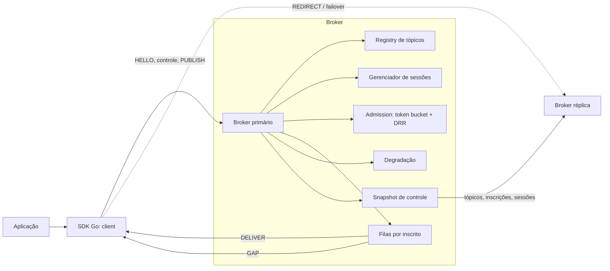

# Middleware Publish/Subscribe — Cenário C

Este projeto implementa em Go um middleware distribuído **Publish/Subscribe** para o **Cenário C — Interação ao Vivo**, definido em `Projeto-PubSub-ProgDistribuida.pdf`. O objetivo é atender aplicações com baixa latência, volume irregular, muitos consumidores e publicadores heterogêneos, como transmissões ao vivo, leilões e jogos interativos.

A entrega da v1 é **at-most-once**: o broker não persiste histórico nem retransmite mensagens no plano de dados. Perdas são detectadas pela sequência por tópico e reportadas ao cliente por `GAP`.

## Índice

1. [Resumo do projeto](#resumo-do-projeto)
2. [Arquitetura](#arquitetura)
3. [Separação dos pacotes](#separação-dos-pacotes)
4. [Fluxos principais](#fluxos-principais)
5. [Protocolo e semântica](#protocolo-e-semantica)
6. [API pública do SDK](#api-pública-do-sdk)
7. [Cenários de teste](#cenários-de-teste)
8. [Métricas e evidências](#métricas-e-evidências)
9. [Requisitos e execução](#requisitos-e-execução)
10. [Comandos disponíveis](#comandos-disponíveis)
11. [Limites conhecidos](#limites-conhecidos)
12. [Avaliação das Etapas 2 e 3](#avaliação-das-etapas-2-e-3)

## Resumo do projeto

O sistema possui três atores principais:

- **Aplicação:** publica eventos, cria tópicos e recebe entregas por callbacks.
- **SDK cliente:** mantém sessão, roteamento conhecido, callbacks assíncronos e detecção de lacunas.
- **Broker:** valida sessões e operações, aplica admissão, atribui sequência, faz fanout e gerencia filas por inscrito.

As decisões arquiteturais seguem `etapa1_distribuida.md`:

- transporte UDP;
- datagrama máximo de 1200 bytes;
- filas limitadas por inscrito;
- política padrão `drop-oldest`;
- controle confiável com `RequestID`, timeout e retry limitado;
- plano de dados sem retransmissão;
- topologia estática na v1;
- replicação assíncrona apenas do estado de controle;
- reconciliação de sessão por `RESUME` e sinalização `GAP`.

## Arquitetura



### Camada de aplicação

A aplicação usa o pacote público `api` e o SDK `client`, sem conhecer endereços internos de partições ou detalhes binários do protocolo.

### Camada cliente

O SDK é responsável por:

- abrir uma sessão com `HELLO/WELCOME`;
- executar callbacks em goroutine separada;
- deduplicar entregas pela sequência;
- informar lacunas pela callback `OnGap`;
- repetir somente operações do plano de controle;
- atualizar rota quando receber `REDIRECT`;
- encerrar o socket e os workers de forma idempotente.

O `PUBLISH` usa uma única transmissão UDP e aguarda `PUB_RESULT`. Ele não retransmite no plano de dados.

### Camada broker

- `topology`: determina partição e primário;
- `topic`: registra tópicos e inscrições;
- `session`: mantém identidade e endereço UDP da sessão;
- `queue`: limita mensagens e bytes por inscrito;
- `admission`: limita taxa por publicador;
- `degrade`: detecta lentidão persistente;
- `replication`: mantém snapshot/heartbeat da continuidade de controle.

## Separação dos pacotes

```text
api/                 contrato público e callbacks
client/              SDK público
internal/wire/       cabeçalho e codecs binários v1
internal/transport/  sockets UDP e controle confiável
internal/broker/     orquestração do broker
internal/topic/      tópicos e inscrições
internal/session/    sessões em memória
internal/queue/      filas limitadas por inscrito
internal/admission/  token bucket e DRR
internal/degrade/    pressão e lento persistente
internal/topology/   partições, hash e epoch
internal/replication/heartbeat e snapshots de controle
metrics/             latência, vazão, perdas e Jain
scenarios/           cenários executáveis de avaliação
cmd/broker/          processo broker UDP
cmd/demo/            exemplo cliente-broker
cmd/bench/           execução dos cenários
configs/             exemplo de topologia estática
results/             evidências JSON/CSV versionadas
```

Regras de dependência:

- `api` não depende de pacotes internos;
- `client` não importa `broker`;
- pacotes internos não dependem de `cmd`;
- `broker` compõe os internos necessários;
- `metrics` observa dados e não decide regras de negócio;
- `scenarios` e testes servem somente para avaliação.

## Fluxos principais

### Conexão

1. `Connect` abre um socket UDP local.
2. O cliente envia `HELLO` com `RequestID`, `ClientID` e `Role`.
3. O broker valida a sessão e devolve `WELCOME`.
4. `WELCOME` confirma `SessionID`, epoch e endereço primário conhecido.

### Publicação e entrega

1. O cliente envia `PUBLISH` uma vez.
2. O broker valida sessão, epoch e tópico.
3. O token bucket e o DRR verificam admissão.
4. Se excedida a taxa, responde `THROTTLE`.
5. Tópico inexistente retorna `PublishTopicNotFound`.
6. Tópico sem inscritos retorna `PublishNoSubscribers`.
7. A publicação aceita recebe sequência monotônica por tópico.
8. A mensagem é copiada para a fila exclusiva de cada inscrito.
9. A fila gera `DELIVER` ou `GAP` conforme seu estado.
10. O cliente deduplica e entrega por callback em sequência crescente.

### Tópicos e inscrições

- `CreateTopic` cria ou confirma um tópico.
- `DeleteTopic` remove o tópico e envia `TOPIC_CLOSED`.
- `Subscribe` cria uma inscrição com callback no SDK.
- `Unsubscribe` remove a inscrição sem fechar a sessão.

Operações de controle usam `RequestID`, timeout/retry limitado e cache de replay no broker.

### Falha e retomada

`RESUME` recebe os últimos cursors vistos por tópico. O broker atualiza o endereço da sessão e informa intervalos ausentes via `GAP`, pois a v1 não possui anel físico de replay.

No estado atual, os componentes internos de heartbeat, snapshot e promoção existem, mas a integração completa dos processos reais ainda não está fechada.

## Protocolo e semântica

### Transporte

- UDP, sem fragmentação na v1;
- cabeçalho binário fixo;
- datagrama máximo de 1200 bytes;
- `PUBLISH` e `DELIVER` não são retransmitidos;
- controle usa confirmação e retry limitado.

### Semântica de entrega

- at-most-once;
- duplicatas possíveis apenas por condições de rede ou teste;
- mensagens atrasadas ou duplicadas são descartadas pela sequência;
- salto de sequência gera `Gap`;
- fila cheia aplica `drop-oldest`;
- fila lenta gera perda observável e degradação local.

### Estados da fila

1. **Normal:** fila abaixo do alerta.
2. **Pressão:** fila acima do limite, com `drop-oldest` e `GAP`.
3. **Lento persistente:** pressão além do período configurado; a inscrição é desconectada logicamente.

## API pública do SDK

```go
client, err := client.Connect(api.Options{
    BrokerAddress:  "127.0.0.1:9000",
    ClientID:       "demo-client",
    Role:           api.RoleBoth,
    ControlTimeout: 750 * time.Millisecond,
    ControlRetries: 2,
    OnDeliver: func(message api.Message) {},
    OnGap: func(gap api.Gap) {},
    OnTopicClosed: func(topic api.Topic) {},
    OnThrottle: func(topic api.Topic, retryMillis uint32) {},
    OnError: func(err api.Error) {},
})
```

```go
result, err := client.Publish(api.Topic("score"), []byte("goal"))
err = client.CreateTopic(api.Topic("score"))
subscriptionID, err := client.Subscribe(api.Topic("score"), callback)
err = client.Unsubscribe(api.Topic("score"), subscriptionID)
err = client.DeleteTopic(api.Topic("score"))
err = client.Close()
```

## Cenários de teste

Os cenários seguem uma interface comum: `Setup`, `Run`, `Report` e `Name`.

### 1. `steady-fanout`

Valida fanout estável para muitos inscritos:

- publica eventos repetidos;
- registra entrega para todos os inscritos;
- mede p50/p99/p99.9;
- mede vazão de publicação e entrega.

### 2. `burst-publisher`

Valida rajada e justiça entre publicadores:

- gera rajadas;
- registra THROTTLE;
- registra vazão aceita;
- calcula índice de Jain.

### 3. `slow-subscriber`

Valida isolamento de um inscrito lento:

- mantém inscrições saudáveis;
- registra overflow do inscrito lento;
- separa perda por causa;
- verifica continuidade das filas saudáveis.

### 4. `primary-failover`

Valida observabilidade de falha:

- registra tempo de recuperação;
- separa perda por failover;
- permite comparar continuidade e perda aceita.

O `primary-failover` atual é principalmente um cenário simulável no pacote `scenarios`. A execução real com dois processos brokers, heartbeat UDP e promoção ainda não está integrada ao `cmd/broker`.

## Métricas e evidências

O pacote `metrics` coleta:

- latência p50/p99/p99.9;
- bytes e mensagens publicados;
- bytes e mensagens entregues;
- perdas por overflow;
- perdas por failover;
- perdas por falha de rede;
- THROTTLE;
- índice de Jain;
- duração do cenário.

Relatórios são exportados em JSON e CSV em `results/`.

Os resultados existentes são evidências iniciais de benchmark/simulação. Para a Etapa 3 devem ser complementados por execução distribuída repetível em vários processos reais.

## Requisitos e execução

### Requisitos

- Go compatível com `go.mod`;
- suporte a UDP;
- portas disponíveis para broker, clientes e réplica.

### Iniciar o broker

```sh
go run ./cmd/broker -address 127.0.0.1:9000
```

Parâmetros:

- `-address`: endereço UDP;
- `-queue-messages`: máximo de mensagens por fila;
- `-queue-bytes`: máximo de bytes por fila.

### Executar o exemplo

Terminal 1:

```sh
go run ./cmd/broker -address 127.0.0.1:9000
```

Terminal 2:

```sh
go run ./cmd/demo -broker 127.0.0.1:9000 -client demo-client
```

## Comandos disponíveis

```sh
make test
make build
make bench
make broker
make demo
```

Executar diretamente:

```sh
go test ./...
go build ./...
```

Listar cenários:

```sh
go run ./cmd/bench -list
```

Executar cenários:

```sh
go run ./cmd/bench -scenario steady-fanout -json results/steady-fanout.json -csv results/steady-fanout.csv
go run ./cmd/bench -scenario burst-publisher -json results/burst-publisher.json -csv results/burst-publisher.csv
go run ./cmd/bench -scenario slow-subscriber -json results/slow-subscriber.json -csv results/slow-subscriber.csv
go run ./cmd/bench -scenario primary-failover -json results/primary-failover.json -csv results/primary-failover.csv
```

## Limites conhecidos

- sem persistência histórica;
- sem anel físico de replay;
- sem retransmissão de `PUBLISH` ou `DELIVER`;
- topologia estática;
- sem membership dinâmico por gossip;
- sem autenticação ou criptografia;
- sem gateway WebSocket/WebTransport;
- heartbeat, snapshot e promoção existem internamente, mas não há composição completa de dois processos no `cmd/broker`;
- reconexão automática com backoff+jitter não está integrada ao SDK;
- o YAML existe como artefato, mas o broker ainda usa flags;
- cenários sintéticos não substituem testes distribuídos reais.

## Avaliação das Etapas 2 e 3

### Etapa 2 — implementação

Estado: **majoritariamente concluída**.

Concluído:

- protocolo wire binário v1;
- broker single-node;
- SDK público;
- tópicos, inscrições e sessões;
- filas por inscrito;
- fanout e GAP;
- token bucket e DRR;
- degradação e isolamento de lento;
- topologia e redirect;
- heartbeat/snapshot internos;
- quatro cenários;
- exportação JSON/CSV;
- demo, broker e bench;
- documentação operacional básica;
- testes unitários por módulo.

Faltante:

1. integrar um cluster real de dois processos brokers;
2. enviar snapshots e heartbeats periodicamente pela rede;
3. promover réplica e alterar epoch/topologia entre processos;
4. implementar reconexão automática no SDK com backoff+jitter;
5. integrar `RESUME` ao ciclo automático do cliente;
6. conectar a configuração YAML ao processo broker;
7. validar a suite inteira em ambiente Go;
8. executar o demo e os cenários em processo real.

### Etapa 3 — avaliação e relatório

Estado: **parcial**.

Concluído:

- métricas de latência, vazão, perdas e Jain;
- quatro cenários definidos;
- resultados JSON/CSV existentes;
- parâmetros repetíveis por código;
- documentação dos limites conhecidos.

Faltante:

1. executar testes reais com vários processos publicadores e consumidores;
2. repetir testes e registrar desvios estatísticos;
3. medir saturação e memória por fila;
4. medir tempo real de recuperação de failover;
5. gerar gráficos finais;
6. justificar ajustes de parâmetros;
7. publicar um relatório final comparando carga, latência, perda e isolamento;
8. incluir evidências reais de conformidade com o Cenário C.

Assim, a Etapa 2 possui base substancial, mas não está integralmente completa. A Etapa 3 permanece parcial até existir execução distribuída reproduzível e relatório baseado em dados reais.
